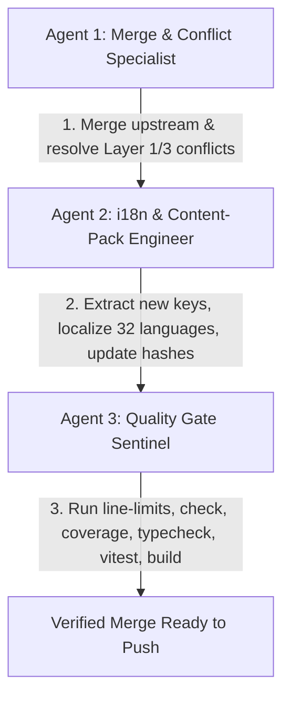

# Heym Upstream Merge & i18n Quality Gate Runbook

This skill guides the automated or agent-team execution of merging upstream releases (`heymrun/heym`) into this internationalized fork (`mat-ban/heym-i18n`), maintaining 100% translation parity across 32 platform languages, and passing all quality gates.

---

## 1. Quick Automated Execution

The automated merge pipeline script handles the entire lifecycle:

```bash
# Full automated run (fetch, merge upstream/main, drift check, unlocalized scan, and all quality gates)
./scripts/merge-upstream.sh

# Target a specific upstream release tag or branch
./scripts/merge-upstream.sh --ref v0.0.130

# Re-run verification after manually resolving conflicts
./scripts/merge-upstream.sh --skip-merge

# Fast verification during iterative translation work
./scripts/merge-upstream.sh --skip-merge --skip-build
```

---

## 2. Agent Team Orchestration Model

When invoked for an upstream merge task (recommended via `/teamwork-preview` or subagent delegation), orchestrate 3 distinct agent roles:



### Role 1: Merge & Conflict Specialist
* **Responsibilities**:
  1. Verify clean git working tree (`git status`).
  2. Ensure remote `upstream` (`https://github.com/heymrun/heym.git`) is configured and fetched (`git fetch upstream`).
  3. Execute merge (`git merge upstream/main` or specified tag).
  4. If conflicts occur, apply the documented conflict resolution rules from [`docs/i18n/ARCHITECTURE.md`](file:///antigravity-project/heym/heym-i18n/docs/i18n/ARCHITECTURE.md):
     * **Layer 1 (Engine)**: In `main.ts`, preserve `app.use(i18n)`.
     * **Layer 3 (Instrumentation)**: In components (`.vue`), accept upstream business logic and re-apply `$t(...)` and `useI18n()` bindings. **Never revert upstream logic changes.**
     * **Rule 3b**: Ensure translated text is never used as raw values or IDs (e.g. `:value="t(...)"` is forbidden; only `label` is translated).

### Role 2: i18n & Content-Pack Engineer
* **Responsibilities**:
  1. Detect upstream drift: `node --experimental-strip-types frontend/scripts/i18n/drift.ts` (checks new node types and credential descriptions).
  2. Scan Vue components for unlocalized raw strings: `node --experimental-strip-types frontend/scripts/i18n/scan-unlocalized.ts`.
  3. Add newly identified keys to `frontend/src/locales/en.json`.
  4. Propagate translations to all 31 target locales (`frontend/src/locales/*.json`), ensuring:
     * Named placeholders match exactly (`{name}`, `{count}`, `{tokens}`).
     * `@` symbols are escaped as `{'@'}`.
     * Formality rules are strictly respected (German formal *Sie*, Polish formal/impersonal, Scandinavian impersonal, Chinese polite form without forbidden *你*).
  5. Synchronize metadata hashes in `frontend/src/locales/_meta/*.json` using sha256 hashes of the English source strings. Format with 1 line per key to strictly respect the 10,000-line repository file limit.
  6. Synchronize release-tour content packs in `frontend/src/content-packs/release/<locale>.json` and `frontend/src/features/release-tour/releaseRegistryDe.ts` when upstream releases introduce new tour items.

### Role 3: Quality Gate Sentinel
* **Responsibilities**:
  Run all 6 Quality Gates in strict sequence. All gates must pass with 0 errors before committing or pushing:
  ```bash
  # Gate 1: Tracked file line limit guard
  ./scripts/check-file-line-limits.sh

  # Gate 2: i18n translation integrity & 100% key parity
  npm run i18n:check --prefix frontend

  # Gate 3: Coverage, freshness hashes & gate status
  npm run i18n:coverage --prefix frontend -- --gate

  # Gate 4: TypeScript compilation verification
  npm run typecheck --prefix frontend

  # Gate 5: Vitest unit suite (86+ test suites, 800+ tests)
  npm run test --prefix frontend

  # Gate 6: Production bundle build (Zero-Rebuild Overlay)
  npm run build --prefix frontend
  ```

---

## 3. Deployment Overlay Verification

When upgrading to a new upstream release:
1. Update `VERSION` file if bumped by upstream.
2. In `docker-compose.yml`, ensure the official image tag matches the release version:
   ```yaml
   services:
     heym:
       image: ghcr.io/heymrun/heym:<version>
       volumes:
         - ./frontend/dist:/app/frontend/dist:ro
   ```
3. Build the frontend (`npm run build --prefix frontend`).
