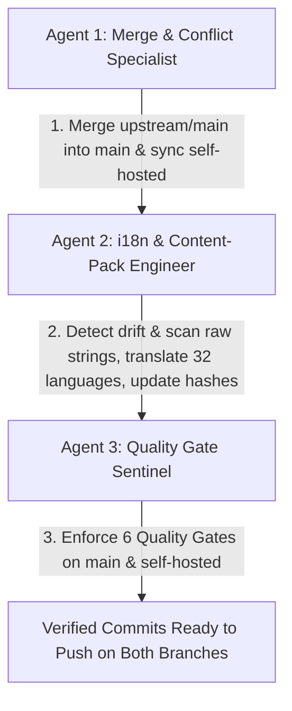

# Heym i18n – Agent Instructions & Project Guidelines

This file provides project-specific context and operational guidelines for Antigravity agents working in the **Heym Internationalization (i18n)** workspace.

---

## 1. Project Context & Dual-Branch Architecture

* **Repository**: Downstream fork of upstream [`heymrun/heym`](https://github.com/heymrun/heym.git) located at [`heym-i18n/`](file:///antigravity-project/heym/heym-i18n).
* **Mission**: Maintaining an enterprise-grade internationalization layer supporting **32 languages** (English source + 31 target languages) with 100% key parity (2,065+ leaf keys) and 130 translated in-app documentation pages per language.
* **Architecture Reference**: Complete details are documented in [`heym-i18n/docs/i18n/ARCHITECTURE.md`](file:///antigravity-project/heym/heym-i18n/docs/i18n/ARCHITECTURE.md).

### The Dual-Branch Model

| Branch | Purpose | Backend State | Deployment Target |
|--------|---------|---------------|-------------------|
| **`main`** | **Pure i18n Layer** (Canonical) | **100% Upstream-Stock** (unmodified) | Zero-Rebuild Overlay (`frontend/dist` mounted over `ghcr.io/heymrun/heym`), PR-ready for Upstream contribution |
| **`self-hosted`** | **Standalone Edition** | **Auth-Enhanced** (`backend/app/api/auth.py` with RFC-1918 LAN cookies & case-insensitive email) | Standalone Docker Container (`ghcr.io/mat-ban/heym`) built via `.github/workflows/publish-release-image.yml` |

---

## 2. Workspace Separation Principle (Scripts & Secrets Outside Code Tree)

> [!IMPORTANT]
> **Pipeline-Skripte und Secrets gehören NIEMALS in das Git-Repository `heym-i18n`!**

Um das Code-Repository sauber und upstream-konform zu halten:
* **Pipeline-Skripte** liegen im übergeordneten Workspace-Ordner [`scripts/`](file:///antigravity-project/heym/scripts/):
  * [`scripts/merge-upstream.sh`](file:///antigravity-project/heym/scripts/merge-upstream.sh) – Merge- und Verifikations-Pipeline
  * [`scripts/release.sh`](file:///antigravity-project/heym/scripts/release.sh) – Dual-Branch Release- und Push-Pipeline
  * [`scripts/release.py`](file:///antigravity-project/heym/scripts/release.py) – Python-Alternative der Release-Pipeline
* **Patches** liegen in [`patches/backend-auth-lan.patch`](file:///antigravity-project/heym/patches/backend-auth-lan.patch).
* **Secrets & Access Tokens** liegen in der übergeordneten Datei [`.env`](file:///antigravity-project/heym/.env) (geschützt durch [`/antigravity-project/heym/.gitignore`](file:///antigravity-project/heym/.gitignore)).
* **Repository-Purity**: Das Repository `heym-i18n/` enthält ausschließlich produktiven Code und i18n-Assets. Die Datei `heym-i18n/.gitignore` bleibt dadurch nahezu 100% identisch zur Upstream-Vorlage (`heymrun/heym`).

---

## 3. Upstream Merge Pipeline (`scripts/merge-upstream.sh`)

Das automatisierte Skript [`scripts/merge-upstream.sh`](file:///antigravity-project/heym/scripts/merge-upstream.sh) synchronisiert Upstream-Releases und verifiziert beide Branches.

### Ausführung (im Workspace-Root `/antigravity-project/heym`)

```bash
# Gesamter automatisierter Durchlauf über BEIDE Branches (Fetch -> Merge -> Quality Gates)
./scripts/merge-upstream.sh

# Ziel-Release-Tag festlegen (z. B. v0.0.130)
./scripts/merge-upstream.sh --ref v0.0.130

# Nur den 'main'-Zweig verifizieren
./scripts/merge-upstream.sh --branch main

# Nur den 'self-hosted'-Zweig verifizieren
./scripts/merge-upstream.sh --branch self-hosted

# Merge überspringen und nur Quality Gates ausführen
./scripts/merge-upstream.sh --skip-merge

# Schneller Testlauf ohne langsamen Frontend-Build
./scripts/merge-upstream.sh --skip-merge --skip-build
```

---

## 4. Agent Team Workflow (Spawning Guidelines)

Wenn ein Antigravity-Agent beauftragt wird, **Upstream-Code zu mergen**, **Übersetzungen zu aktualisieren** oder die **Pipeline auszuführen**, spawnt ein **3-Agenten-Team**:



### Agent 1: Merge & Conflict Specialist
1. Prüfen, dass der Arbeitsbaum sauber ist (`git status`).
2. Upstream fetchen (`git fetch upstream`).
3. `./scripts/merge-upstream.sh` ausführen (oder manuell mergen):
   * **Auf `main`**:
     * Upstream mergen (`git merge upstream/main`).
     * Layer 1 (`main.ts` -> `app.use(i18n)`) und Layer 3 (`.vue` Komponenten -> `$t(...)` anpassen, Upstream-Logik erhalten).
     * Backend-Purity erzwingen: `backend/app/api/auth.py` bleibt zu 100% identisch zu `upstream/main`.
   * **Auf `self-hosted`**:
     * `main` in `self-hosted` mergen.
     * Den Patch [`patches/backend-auth-lan.patch`](file:///antigravity-project/heym/patches/backend-auth-lan.patch) anwenden bzw. Konflikte zugunsten der LAN-Cookies und E-Mail-Normalisierung auflösen.

### Agent 2: i18n Catalog & Content-Pack Engineer
1. **Drift Detection**: `node --experimental-strip-types frontend/scripts/i18n/drift.ts`.
2. **Template Scanning**: `node --experimental-strip-types frontend/scripts/i18n/scan-unlocalized.ts`.
3. **Catalog Synchronization**:
   * Neue Keys in `frontend/src/locales/en.json` eintragen.
   * In alle 31 Zielsprachen übersetzen (`frontend/src/locales/<locale>.json`).
   * `@` als `{'@'}` escapen.
   * Platzhalter (`{name}`, `{count}`) exakt beibehalten.
   * Höflichkeitsregeln beachten (deutsches *Sie*, skandinavisches/polnisches Passiv, chinesische Höflichkeitsform).
4. **Metadata & Hashes**:
   * SHA-256 Hashes in `frontend/src/locales/_meta/<locale>.json` aktualisieren (1 Zeile pro Key).
5. **Content Packs**:
   * Alle 31 Dateien in `frontend/src/content-packs/release/<locale>.json` synchronisieren.

### Agent 3: Quality Gate Sentinel
Führt alle 6 Quality Gates auf beiden Zweigen aus:
```bash
cd heym-i18n

# Gate 1: Tracked file line limit guard (< 10,000 lines)
./scripts/check-file-line-limits.sh

# Gate 2: i18n translation integrity & 100% key parity
npm run i18n:check --prefix frontend

# Gate 3: Coverage, freshness hashes & gate status
npm run i18n:coverage --prefix frontend -- --gate

# Gate 4: TypeScript compilation verification
npm run typecheck --prefix frontend

# Gate 5: Vitest unit suite (86+ test suites, 800+ tests)
npm run test --prefix frontend

# Gate 6: Production bundle build
npm run build --prefix frontend
```

### End-to-End Zyklus bei neuem Upstream-Release (z. B. v0.0.130)

Für vollständige Wiederholbarkeit läuft jedes zukünftige Update in 4 Schritten ab:

1. **Synchronisation anstoßen:**
   ```bash
   ./scripts/merge-upstream.sh --ref v0.0.130
   ```
2. **Lokalisieren & Hashes auffrischen:**
   * Neue Keys aus Upstream in alle 31 Sprachen übertragen.
   * Hashes in `frontend/src/locales/_meta/*.json` aktualisieren.
3. **Verifizieren:**
   ```bash
   ./scripts/merge-upstream.sh --skip-merge
   ```
4. **Release erstellen und pushen:**
   ```bash
   ./scripts/release.sh --push
   ```

---

## 5. GitHub Release Pipeline (`scripts/release.sh`)

Die Release-Pipeline liegt in [`scripts/release.sh`](file:///antigravity-project/heym/scripts/release.sh) (Python-Pendant: [`scripts/release.py`](file:///antigravity-project/heym/scripts/release.py)).

### Funktionsweise & Kernfeatures

* **Token-Handling aus `.env`**: Das Skript liest das GitHub-Token automatisch aus der Workspace-Datei [`.env`](file:///antigravity-project/heym/.env) (`GITHUB_TOKEN=...` oder `GH_TOKEN=...`), ohne dass Secrets in Git abgelegt oder als Befehlsparameter übergeben werden müssen.
* **Squash-before-Push**: Konsolidiert alle lokalen Zwischen-Commits auf `main` in **genau einen gesamtheitlichen Release-Commit** auf Basis von `origin/main` (`v0.0.128`), damit die GitHub-Historie frei von Entwicklungs-Clutter bleibt.
* **Dual-Branch Synchronization**: Synchronisiert `self-hosted` als sauberen 1-Commit-Diff auf `main` via [`patches/backend-auth-lan.patch`](file:///antigravity-project/heym/patches/backend-auth-lan.patch).
* **Release Packaging & Uploads**:
  * Releases auf GitHub folgen exakt der Struktur von [v0.0.128](https://github.com/mat-ban/heym-i18n/releases/tag/v0.0.128).
  * Referenziert automatisch die Upstream Base (`https://github.com/heymrun/heym/releases/tag/v0.0.129`).
  * Aggregiert alle Changes und Highlights seit dem Vorgänger-Tag.
  * Hängt zusätzlich zum `main`-Quellcode beide Source-Archive von `self-hosted` (`heym-self-hosted-v<TAG>.tar.gz` und `.zip`) an das Release an.
* **Forensischer Privacy-Scan**: Prüft vor jedem Taggen auf verbotene Dateien (`.env`, `deployment.env`) und verhindert Leaks interner IPs oder Test-Mails.

### Erforderliche Token-Berechtigungen (in `.env`)

Wenn ein neues GitHub Personal Access Token (PAT) erstellt wird:
* **Fine-grained Personal Access Token (Empfohlen):**
  * Repository: `mat-ban/heym-i18n`
  * Permissions:
    * `Contents`: **Read and write** (Pushes von Branches, Tags und Releases)
    * `Workflows`: **Read and write** (⚠️ **Zwingend erforderlich!** Da `.github/workflows/` im Repository liegt, verweigert GitHub Pushes ohne dieses Recht mit HTTP 403)
    * `Metadata`: **Read-only**
* **Classic Personal Access Token:**
  * Scopes: `repo` und `workflow`

### Quick Commands (im Workspace-Root `/antigravity-project/heym`)

```bash
# Lokaler Probelauf (Gates prüfen, main squashen, self-hosted syncen, Tag erstellen, Archive prüfen)
./scripts/release.sh --no-push

# Schneller Probelauf (überspringt langsamen Bundle-Build)
./scripts/release.sh --no-push --skip-build

# Release nach GitHub übertragen (nutzt Token aus /antigravity-project/heym/.env)
./scripts/release.sh --push

# Manuelle Token-Übergabe oder spezifische Version
./scripts/release.sh --version 0.0.129 --token "$GITHUB_TOKEN" --push
```

---

## 6. Troubleshooting & System-Besonderheiten

* **WSL / Git-Lockfiles**:
  Auf Windows/WSL Dateisystemgrenzen können bei unterbrochenen Vorgängen verwaiste `.git/*.lock`-Dateien verbleiben (`.git/ORIG_HEAD.lock`, `.git/index.lock`). Beide Skripte (`merge-upstream.sh` und `release.sh`) bereinigen diese Locks automatisch im Pre-flight.
* **Backend-Purity auf `main` verifizieren**:
  ```bash
  git diff upstream/main..main backend/
  ```
  *Muss exakt 0 Zeilen Unterschied ergeben.*
* **Diff-Purity auf `self-hosted` verifizieren**:
  ```bash
  git diff main..self-hosted --name-only
  ```
  *Muss exakt nur `backend/app/api/auth.py` ausgeben.*

---

## 7. Checkliste vor Abschluss

- [ ] Working Tree ist sauber auf beiden Branches (`git status`).
- [ ] Keine Pipeline-Skripte oder `.env`-Dateien innerhalb von `heym-i18n/`.
- [ ] `main` hat 0 Diffs in `backend/` gegenüber `upstream/main`.
- [ ] `self-hosted` unterscheidet sich von `main` ausschließlich in `backend/app/api/auth.py`.
- [ ] 100% Key-Parität über alle 32 Sprachen (2.065+ Leaf Keys, 130 Docs pro Sprache).
- [ ] Alle 6 Quality Gates auf beiden Branches bestanden.
- [ ] Genau 1 konsolidierter Commit auf `main` vor `origin/main`.
- [ ] Beide Branches und das Release-Tag sind nach GitHub übertragen:
  ```bash
  git push origin main
  git push origin self-hosted
  git push origin v0.0.129
  ```
