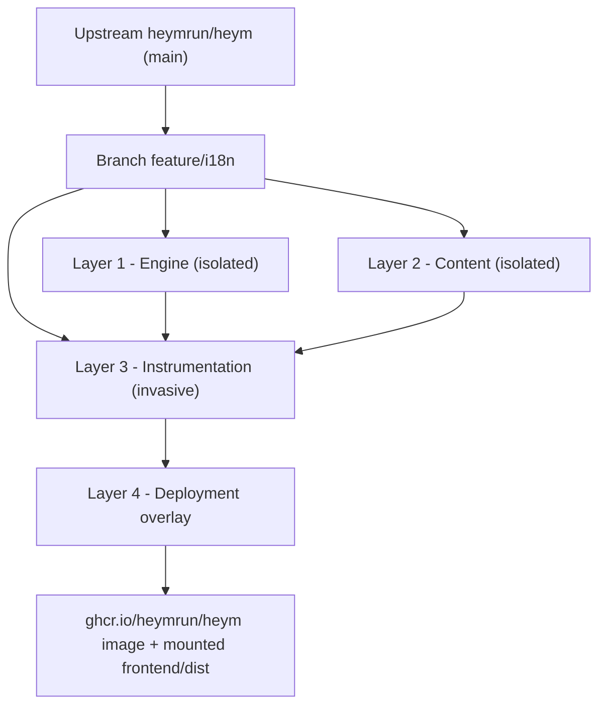
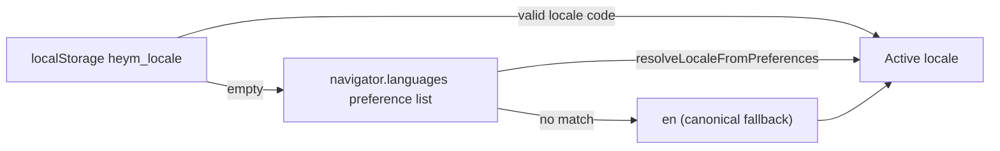

# Internationalization (i18n) Architecture

> **Branch:** `feature/i18n` · **Base:** `heymrun/heym` `main` @ `v0.0.128`
> **Languages:** 32 enterprise platform languages (English `en` as canonical source + 31 target languages)
> **Status:** UI 100 % (2,011 leaf keys, full parity across all 32 locales) · In-app docs 100 % (4,128 markdown files, 129 / 129 pages per language, 100 % Tier-A coverage)

This document explains how the multi-language support on this branch is built, how much of the upstream code it touches, how to keep it in sync with upstream, and how languages are managed and scaled.

---

## Contents

1. [Scope](#1-scope)
2. [Patch Footprint: Four Layers](#2-patch-footprint-four-layers)
3. [Runtime Behavior](#3-runtime-behavior)
4. [Translation Catalog Conventions](#4-translation-catalog-conventions)
5. [Quality Gates](#5-quality-gates)
6. [Terminology Glossary](#6-terminology-glossary)
7. [Rebasing onto Upstream](#7-rebasing-onto-upstream)
8. [Language Architecture & Scalability](#8-language-architecture--scalability)
9. [Deployment (Zero-Rebuild Overlay)](#9-deployment-zero-rebuild-overlay)
10. [Known Limitations & Roadmap](#10-known-limitations--roadmap)

---

## 1. Scope

| Area | Localized | Notes |
|------|:---------:|-------|
| App shell, navigation, header, login / register | ✅ | `nav`, `header`, `auth` namespaces |
| All dashboard tabs (Workflows, Board, MCP, Analytics, Dashboards, Drive, Logs, …) | ✅ | One namespace per tab |
| Workflow editor: canvas, node library, properties panels, dialogs | ✅ | `canvas`, `nodes`, `propertiesPanel` |
| Execution history, traces, evals, credentials, vector stores, schedules | ✅ | Fully localized across all 32 languages |
| Showcase / feature tour / release notes | ✅ | Dynamic content packs (`src/content-packs/{intro,showcase,release}/`) and localized registries |
| In-app documentation (`/docs/...`) | ✅ | 129 Markdown pages per language across all 32 locales, lazy-loaded raw chunks |
| Backend API error messages (`detail` strings) | ❌ | Rendered as delivered by the backend (English) |
| Plugin documentation (served by backend) | ❌ | Rendered as delivered by the plugin |
| Workflow content created by users | ❌ | User data is never translated |

The backend is **not modified** by this branch. All changes live in `frontend/`.

---

## 2. Patch Footprint: Four Layers

Vue has no plugin mechanism that can translate text living inside component templates. Every component that renders user-facing text must therefore be edited. The branch is consequently a **fork branch with an isolated engine**, not a drop-in add-on.



### Layer 1 – Engine (isolated, new files)

| File | Purpose |
|------|---------|
| [`frontend/src/i18n/index.ts`](../../frontend/src/i18n/index.ts) | Creates the `vue-i18n` instance (Composition API, `legacy: false`), lazy loading, locale detection, persistence, `setLocale()`, `getCurrentLocale()`, keeps `<html lang>` in sync |
| [`frontend/src/i18n/locales.ts`](../../frontend/src/i18n/locales.ts) | Central registry of all 32 supported locales (`ALL_LOCALES`), BCP 47 mapping, scripts, tiers, aliases, and preference resolution |
| [`frontend/src/i18n/plural.ts`](../../frontend/src/i18n/plural.ts) | CLDR pluralization rules across diverse language families (1-form, 2-form, 3-form, 4-form) |
| [`frontend/src/i18n/format.ts`](../../frontend/src/i18n/format.ts) | Standardized date, time, and number formatting via `Intl` APIs |
| [`frontend/src/i18n/pseudo.ts`](../../frontend/src/i18n/pseudo.ts) | Pseudo-localization generator (`en-XA`) for truncation and layout expansion testing |
| [`frontend/scripts/check-i18n.ts`](../../frontend/scripts/check-i18n.ts) | Static integrity check (`npm run i18n:check`), see [§5](#5-quality-gates) |
| [`frontend/scripts/i18n/coverage.ts`](../../frontend/scripts/i18n/coverage.ts) | Multi-language coverage, freshness hash verification, and gate reporting (`npm run i18n:coverage`) |
| [`frontend/scripts/i18n/drift.ts`](../../frontend/scripts/i18n/drift.ts) | Upstream drift detection for node and credential definitions (`npm run i18n:drift`) |
| [`frontend/scripts/i18n/translate.ts`](../../frontend/scripts/i18n/translate.ts) | Automated translation and catalog synchronizer |
| [`frontend/e2e/i18n-ui.spec.ts`](../../frontend/e2e/i18n-ui.spec.ts), [`i18n-docs.spec.ts`](../../frontend/e2e/i18n-docs.spec.ts) | Playwright specs run by the standard E2E harness |
| `frontend/src/main.ts` | +2 lines: `app.use(i18n)` |
| `frontend/package.json` | +`vue-i18n@^11`, +i18n validation scripts |

> [!NOTE]
> The source catalog `en.json` is imported with `with { type: "json" }`. Without the import attribute, Node's native ESM loader (used by Playwright to load `e2e/support.ts`, which transitively imports `i18n/index.ts`) rejects the JSON import and **every** E2E spec fails at load time.

### Layer 2 – Content (isolated, pure data)

| Path | Content |
|------|---------|
| [`frontend/src/locales/en.json`](../../frontend/src/locales/en.json) | Source catalog (canonical reference, 2,011 leaf keys in 37 namespaces) |
| `frontend/src/locales/<locale>.json` | 31 target locale catalogs (`de`, `pl`, `fr`, `es`, `zh-Hans`, `zh-Hant`, `ja`, etc.) with 100% key parity |
| `frontend/src/locales/_meta/<locale>.json` | Freshness hashes (`h`) of English sources and translation state (`s`) for drift monitoring |
| `frontend/src/docs/content/<locale>/**/*.md` | 129 translated documentation pages per language across all 32 locales, mirroring the English hierarchy |
| `frontend/src/features/showcase/showcaseRegistry<Locale>.ts` | Localized showcase definitions with fallback to English |
| `frontend/src/features/release-tour/releaseRegistry<Locale>.ts` | Localized release-tour entries with fallback to English |

### Layer 3 – Instrumentation (invasive, upstream files)

~150 Vue components and views had hard-coded strings replaced with `$t('namespace.key')` / `t('namespace.key')`. **Only strings were swapped. No logic, layout or behavior was changed.** The largest touch points:

| File | Changed lines |
|------|--------------:|
| `views/EditorView.vue` | ~230 |
| `components/MCP/MCPPanel.vue` | ~180 |
| `docs/manifest.ts` | ~170 (localized titles, see [§3.3](#33-in-app-documentation)) |
| `components/VectorStores/VectorStoresPanel.vue` | ~160 |
| `components/Layout/UserSettingsDialog.vue` | ~135 (language switcher across 32 locales) |
| `components/Traces/TracesPanel.vue` | ~130 |

Most other components have small diffs (5–50 lines). These files are where rebase conflicts occur (see [§7](#7-rebasing-onto-upstream)).

### Layer 4 – Deployment overlay

The compiled `frontend/dist` is bind-mounted over the UI of the unmodified official image. See [§9](#9-deployment-zero-rebuild-overlay).

---

## 3. Runtime Behavior

### 3.1 Locale resolution



- Users switch the language in **User Settings → Language**. All 32 supported languages are listed with their native endonyms (e.g. `English`, `Deutsch`, `Polski`, `Français`, `Español`, `Italiano`, `Português`, `日本語`, `한국어`, `简体中文`, `繁體中文`, etc.).
- `resolveLocaleFromPreferences()` matches browser preferences, locale tags, and regional aliases (e.g. `de-AT` → `de`, `pl-PL` → `pl`, `pt-BR` → `pt-BR`, `zh-TW` → `zh-Hant`, `en-US` → `en`).
- `setLocale()` updates the i18n instance, dynamically loads target locale messages on-demand, writes `localStorage.heym_locale`, and updates `<html lang="...">`.
- The switch is reactive. No reload is required.
- The preference is stored **per browser**, not per user account.

### 3.2 UI strings

- Canonical source catalog `en.json` is bundled statically. Target language catalogs are loaded asynchronously on-demand or preloaded.
- `fallbackLocale: "en"`: a key missing in any target catalog renders the English text instead of the raw key.
- The quality gate `npm run i18n:check` prevents missing keys from shipping, ensuring 100% parity across all 32 locales.

### 3.3 In-app documentation

Documentation pages are loaded **lazily** through `import.meta.glob("@/docs/content/**/*.md", { query: "?raw" })`. Each page is its own chunk, so translations do not increase the initial bundle size.

Resolution in [`DocContent.vue`](../../frontend/src/components/Docs/DocContent.vue) (`findModuleKey`):

1. For active locale `<lang>`, look for `content/<lang>/<category>/<slug>.md`.
2. Otherwise, or if no localized file exists for that slug, fall back to canonical `content/<category>/<slug>.md`.
3. If neither exists, show `docs.pageNotFound`.

This **per-page fallback** means a new upstream page shows up immediately in English across all languages, without broken links.

Sidebar categories and page titles come from [`manifest.ts`](../../frontend/src/docs/manifest.ts): `getDocsManifest(locale)` overlays localized category labels and titles onto the upstream `DOCS_MANIFEST`. Missing entries fall back to the English title.

Additional renderer changes:
- Headings get slugified `id` attributes (and `id` is allowed in DOMPurify), so anchor links such as `#parameters` work across all languages.
- Internal links in translated pages point to the same slugs as the English pages. Routes are language-neutral.

Code blocks, the expression DSL (`{{ $... }}`), JSON examples and cURL commands are **never translated**. Every snippet stays copy-paste executable.

### 3.4 Showcase and release registries

The feature showcase and the release tour use rich TypeScript objects instead of flat strings. They utilize locale resolvers (`showcaseResolver.ts`) that select the appropriate localized registry (e.g. `*RegistryDe.ts`, etc.) with automatic fallback to the English registry.

### 3.5 Dates and numbers

Date, time, and number formatting is standardized via `formatDate()` and `formatNumber()` in [`frontend/src/i18n/format.ts`](../../frontend/src/i18n/format.ts), mapping each locale to its standard BCP 47 tag (e.g. `de-DE`, `fr-FR`, `pl-PL`, `en-US`) from `locales.ts`.

---

## 4. Translation Catalog Conventions

**Namespaces** (top-level keys, identical in every locale):

`common` · `nav` · `header` · `auth` · `settings` · `workflows` · `releaseTour` · `canvas` · `nodes` · `propertiesPanel` · `vectorStores` · `credentials` · `traces` · `tables` · `dashboard` · `schedules` · `evals` · `statusFilter` · `activeWorkflows` · `quickDrawer` · `showcase` · `curl` · `chat` · `teams` · `alerts` · `history` · `portal` · `templates` · `variables` · `board` · `mcp` · `analytics` · `dashboards` · `drive` · `logs` · `workflowHistory` · `docs`

**Rules**

| Rule | Example |
|------|---------|
| Keys are `camelCase`, grouped by feature, never by language | `credentials.shareDialog.title` |
| Shared verbs and labels live in `common` | `common.save`, `common.cancel` |
| Use named interpolation, never string concatenation | `"Deleted {count} workflows"` instead of `t('a') + n + t('b')` |
| Named placeholders must match source exactly across all 32 locales | `{name}`, `{tokens}`, `{count}` |
| `@` must be escaped, otherwise the compiler fails with `INVALID_LINKED_FORMAT` | `"user{'@'}example.com"` |
| Lines that must stay literal can be skipped by the scanner | `<!-- i18n-ignore -->` / `// i18n-ignore` |
| In `<script setup>` use the global scope | `const { t } = useI18n({ useScope: "global" })` |

---

## 5. Quality Gates

Run all gates before every commit. Run them from `frontend/`:

```bash
npm run i18n:check      # translation integrity, key parity & formality (Node.js >= 22.18, native TS type stripping)
npm run i18n:coverage   # catalog coverage, freshness hash verification & gate status
npm run i18n:drift      # upstream drift detection for node and credential definitions
npm run typecheck       # TypeScript verification
npm run test            # Vitest unit tests
npm run build           # Production build verification
```

### `i18n:check`

| # | Check | Scope | Result on failure |
|---|-------|-------|-------------------|
| 1 | All required locale files exist and parse as JSON | All 32 locales | Error, abort |
| 2 | **Key parity**: identical flattened key tree in `en.json` and all target catalogs | All 32 locales | Error |
| 2a | No empty translations | All 32 locales | Error |
| 2b | **Placeholder parity**: identical interpolation variables (`{name}`, `{count}`) | All 32 locales | Error |
| 2c | No unescaped `@` | All 32 locales | Error |
| 2d | **Formality enforcement** (e.g. German formal *Sie*, Polish formal/impersonal, Scandinavian impersonal, Chinese polite form) | Supported locales | Error |
| 2e | Values identical to English are reported unless allow-listed (`IDENTICAL_TERM_ALLOWLIST`: brand names and technical terms) | All target locales | Warning |
| 3 | **Code scan** of all `.vue` / `.ts` files: every `t('…')` / `$t('…')` key must exist in `en.json` | Whole frontend | Error |
| 3a | Heuristic detection of hard-coded text in templates | Whole frontend | Warning |
| 3b | **Display text must not become data**: `:value="$t(…)"`, `value: t(…)` and comparisons against a translated string (`=== t(…)`) are rejected. Option values, IDs and filter states stay language-neutral; only the `label` is translated | Whole frontend | Error |

Current baseline result: `2,011 keys across all 32 locales · 100% key parity · 0 missing · 0 empty · 0 invalid keys · 0 translated-text-as-value`.

### E2E specs (Playwright)

Static checks cannot see text that is assembled at runtime, so specs in [`frontend/e2e/`](../../frontend/e2e/) crawl a running instance. They use the standard harness (`run_e2e.sh`: throw-away PostgreSQL, backend, Vite dev server, shared test user from `global-setup.ts`) and therefore need **no credentials and no fixed host**. They run in the normal PR checks.

```bash
./run_e2e.sh e2e/i18n-docs.spec.ts e2e/i18n-ui.spec.ts   # only the i18n specs
./run_e2e.sh                                              # complete suite
```

| Spec | What it proves |
|------|----------------|
| [`i18n-docs.spec.ts`](../../frontend/e2e/i18n-docs.spec.ts) | Routes come from `DOCS_MANIFEST`. Each page renders its translated source; the sidebar shows localized category labels; English users keep English sources; the manifest localizes titles; missing translations gracefully fall back without broken routes |
| [`i18n-ui.spec.ts`](../../frontend/e2e/i18n-ui.spec.ts) | 16 dashboard tabs, the evaluation view, the run-history dialog and the user-settings dialog render properly localized text; browser-language detection, stored preference and live language switching work seamlessly |

**English fidelity:** The upstream E2E suite asserts English wording. `en.json` must therefore reproduce the upstream text *verbatim* (`Create account`, not `Sign up`; lowercase `read`/`write` badges, …). Treat the unmodified upstream suite as the oracle: after changing `en.json` or a component, run the complete `./run_e2e.sh`.

---

## 6. Terminology Glossary

Translations must maintain consistent terminology in the UI and in documentation. Established technical terms are **not** translated across Latin-script languages.

**Kept in English** (Latin-script languages):
`Trigger` · `Webhook` · `API` · `Workflow` · `Payload` · `Token` · `Endpoint` · `Cron` · `Prompt` · `OAuth` · `SSO` · `Docker` · `Cluster` · `MCP` · `SSE` · `stdio` · `JSON` · `cURL` · `Heym`

**Standard Translated UI Terms (Reference: German)**

| English | Deutsch |
|---------|---------|
| Executions / Traces | Ausführungen |
| Evals | Evaluierung |
| Credentials | Anmeldedaten |
| Vector Stores | Vektorspeicher |
| Schedules | Zeitpläne |
| Data Tables | Datentabellen |
| Alerts | Warnungen |
| Variables | Variablen |
| Templates | Vorlagen |
| History | Verlauf |
| Logs | Protokolle |
| Analytics | Analysen |
| Settings | Einstellungen |
| Properties | Eigenschaften |

*(Similar standardized glossaries are applied across the other 30 target languages to avoid ambiguous synonyms.)*

---

## 7. Rebasing onto Upstream

```bash
git fetch upstream
git rebase upstream/main          # or: git merge upstream/main
cd frontend && npm install
npm run i18n:drift && npm run i18n:check && npm run typecheck && npm run test && npm run build
```

**Where conflicts happen**

| Layer | Conflict risk | How to resolve |
|-------|---------------|----------------|
| 1 – Engine | Very low (isolated files, +2 lines in `main.ts`) | Re-add `app.use(i18n)` |
| 2 – Content | None (isolated files in `locales/`, `docs/content/<locale>/`) | – |
| 3 – Instrumentation | **High** for actively developed components | **Take the upstream version, then re-apply the `$t()` replacements. Never revert upstream logic changes.** |
| `docs/manifest.ts` | Medium | Keep upstream's `DOCS_MANIFEST`. Add localized titles for new slugs. |

**What needs a manual look after a rebase**

- **Changed English text** for an existing key or doc page: Parity checks stay green, but target translations may be stale. Run `npm run i18n:coverage` to identify stale keys via source hash comparisons in `_meta/*.json`.
- **New doc pages**: Appear in English by default. Add translated markdown files under `content/<lang>/` or allow missing during transit.
- **New hard-coded strings in upstream components**: Upstream feature additions introduce raw strings. Extract them into `en.json`, wrap components in `$t(...)`, and propagate translations to all 31 target locales.

---

## 8. Language Architecture & Scalability

The internationalization platform supports **32 enterprise languages** managed through a unified architecture:

1. **Central Locale Registry** ([`frontend/src/i18n/locales.ts`](../../frontend/src/i18n/locales.ts)):
   - Defines all 32 locales (`en`, `de`, `pl`, `fr`, `es`, `it`, `nl`, `pt`, `pt-BR`, `cs`, `sk`, `hu`, `ro`, `bg`, `el`, `da`, `sv`, `fi`, `et`, `lv`, `lt`, `sl`, `hr`, `tr`, `uk`, `ru`, `ja`, `ko`, `zh-Hans`, `zh-Hant`, `id`, `vi`).
   - Maps language codes, native endonyms, BCP 47 `intl` formatting tags, scripts (Latin, Cyrillic, Greek, CJK, Hangul), and locale aliases for automatic browser detection.
2. **CLDR Plural Rules** ([`frontend/src/i18n/plural.ts`](../../frontend/src/i18n/plural.ts)):
   - Implements `cldrPluralRule()` to handle complex cardinal forms across diverse language groups (e.g. standard 2-form for Germanic/Romance, 3-form for Latvian, 4-form for Slavic languages like Polish/Russian/Ukrainian/Slovenian).
3. **Freshness Tracking & Metadata** (`frontend/src/locales/_meta/`):
   - Stores sha256 source hashes (`h`) and review status (`s`) for every translation key, enabling automated drift detection when upstream English strings change.
4. **Coverage & Quality Gates** ([`frontend/scripts/i18n/coverage.ts`](../../frontend/scripts/i18n/coverage.ts)):
   - Validates Catalog Coverage ($K$), Currency ($F$), Structural Quality ($Q$), Review State ($V$), and Docs Coverage ($D$) per locale.
5. **Pseudo-Localization Engine** ([`frontend/src/i18n/pseudo.ts`](../../frontend/src/i18n/pseudo.ts)):
   - Automatically expands text by +30–40% with accented glyphs (`[Àñý ţéxţ...]`) while preserving variables and HTML tags, enabling automated testing for UI clipping and layout responsiveness.
6. **Synchronizer & Translation Utilities** ([`frontend/scripts/i18n/translate.ts`](../../frontend/scripts/i18n/translate.ts)):
   - Command-line tooling for batch translation and updating target language catalogs when new upstream keys are introduced.

---

## 9. Deployment (Zero-Rebuild Overlay)

The official image is used unchanged. Only the compiled frontend is replaced via a read-only bind mount:

```yaml
services:
  heym:
    image: ghcr.io/heymrun/heym:0.0.128   # pin to the version the branch is based on
    volumes:
      - ./frontend/dist:/app/frontend/dist:ro
```

```bash
cd frontend && npm run build
tar -C dist -cf - . | ssh <host> "cd <stack>/frontend/dist && tar -xf -"
ssh <host> "cd <stack> && sudo docker compose restart heym"
```

> [!WARNING]
> The mounted `dist` must match the **backend version of the image**. With `:latest`, an upstream release can change API contracts while the overlay still contains the old frontend. Pin the image tag and update it together with each rebase.

---

## 10. Known Limitations & Roadmap

| Item | Status |
|------|--------|
| Support for 32 enterprise languages | ✅ Done (Full 100% key parity across all 32 locales) |
| In-app documentation for all 32 languages | ✅ Done (129 pages per language, 4,128 markdown files) |
| Central locale registry & dynamic switcher | ✅ Done ([`locales.ts`](../../frontend/src/i18n/locales.ts)) |
| CLDR Pluralization engine | ✅ Done ([`plural.ts`](../../frontend/src/i18n/plural.ts)) |
| Source hash freshness tracking & coverage report | ✅ Done ([`coverage.ts`](../../frontend/scripts/i18n/coverage.ts)) |
| Pseudo-localization generator (`en-XA`) | ✅ Done ([`pseudo.ts`](../../frontend/src/i18n/pseudo.ts)) |
| Live Playwright crawlers | ✅ Done ([`i18n-ui.spec.ts`](../../frontend/e2e/i18n-ui.spec.ts), [`i18n-docs.spec.ts`](../../frontend/e2e/i18n-docs.spec.ts)) |
| Upstream contribution | Goal: Upstream Layers 1 and 3, so forks only need to carry Layer 2 (translations) |
| Backend error messages in English | Open. Long-term: error codes from the API, translated in the frontend |
| Locale is stored per browser, not per account | Open |
