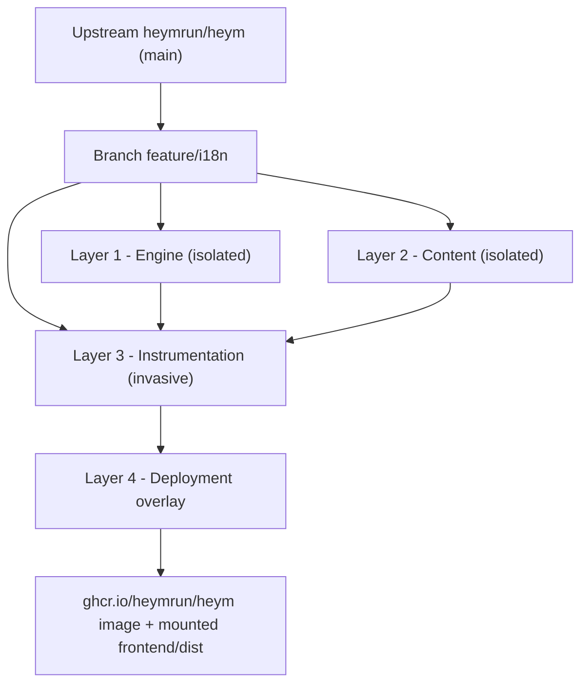
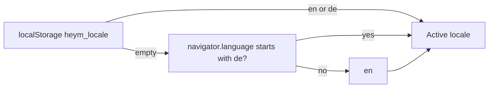

# Internationalization (i18n) Architecture

> **Branch:** `feature/i18n` · **Base:** `heymrun/heym` `main` @ `v0.0.128`
> **Languages:** 32 enterprise platform languages (English `en` as canonical source + 31 target languages)
> **Status:** UI 100 % (2,011 leaf keys, full parity across all 32 locales) · In-app docs 100 % (4,128 markdown files, 129 / 129 pages per language, 100 % Tier-A coverage)

This document explains how the multi-language support on this branch is built, how much of the upstream code it touches, how to keep it in sync with upstream, and how to add further languages.

---

## Contents

1. [Scope](#1-scope)
2. [Patch Footprint: Four Layers](#2-patch-footprint-four-layers)
3. [Runtime Behavior](#3-runtime-behavior)
4. [Translation Catalog Conventions](#4-translation-catalog-conventions)
5. [Quality Gates](#5-quality-gates)
6. [Terminology Glossary](#6-terminology-glossary)
7. [Rebasing onto Upstream](#7-rebasing-onto-upstream)
8. [Adding a New Language](#8-adding-a-new-language)
9. [Deployment (Zero-Rebuild Overlay)](#9-deployment-zero-rebuild-overlay)
10. [Known Limitations & Roadmap](#10-known-limitations--roadmap)

---

## 1. Scope

| Area | Localized | Notes |
|------|:---------:|-------|
| App shell, navigation, header, login / register | ✅ | `nav`, `header`, `auth` namespaces |
| All dashboard tabs (Workflows, Board, MCP, Analytics, Dashboards, Drive, Logs, …) | ✅ | One namespace per tab |
| Workflow editor: canvas, node library, properties panels, dialogs | ✅ | `canvas`, `nodes`, `propertiesPanel` |
| Execution history, traces, evals, credentials, vector stores, schedules | ✅ | |
| Showcase / feature tour / release notes | ✅ | Dynamic content packs (`src/content-packs/{intro,showcase,release}/`) |
| In-app documentation (`/docs/...`) | ✅ | 129 Markdown pages per language across all 32 locales, lazy-loaded raw chunks |
| Backend API error messages (`detail` strings) | ❌ | Rendered as delivered by the backend (English) |
| Plugin documentation (served by backend) | ❌ | Rendered as delivered by the plugin |
| Workflow content created by users | ❌ | User data is never translated |

The backend is **not modified** by this branch. All changes live in `frontend/`.

---

## 2. Patch Footprint: Four Layers

Vue has no plugin mechanism that can translate text living inside component templates. Every component that renders user-facing text must therefore be edited. The branch is consequently a **fork branch with an isolated engine**, not a drop-in add-on.



### Layer 1 – Engine (isolated, new files)

| File | Purpose |
|------|---------|
| [`frontend/src/i18n/index.ts`](../../frontend/src/i18n/index.ts) | Creates the `vue-i18n` instance (Composition API, `legacy: false`), locale detection, persistence, `setLocale()`, `getCurrentLocale()`, keeps `<html lang>` in sync |
| [`frontend/scripts/check-i18n.ts`](../../frontend/scripts/check-i18n.ts) | Static integrity check (`npm run i18n:check`), see [§5](#5-quality-gates) |
| [`frontend/e2e/i18n-ui.spec.ts`](../../frontend/e2e/i18n-ui.spec.ts), [`i18n-docs.spec.ts`](../../frontend/e2e/i18n-docs.spec.ts) | Playwright specs run by the standard E2E harness, see [§5](#5-quality-gates) |
| `frontend/src/main.ts` | +2 lines: `app.use(i18n)` |
| `frontend/package.json` | +`vue-i18n@^11`, +`i18n:check` script |

> [!NOTE]
> The catalogs are imported with `with { type: "json" }`. Without the import attribute, Node's native ESM loader (used by Playwright to load `e2e/support.ts`, which transitively imports `i18n/index.ts`) rejects the JSON import and **every** E2E spec fails at load time.

### Layer 2 – Content (isolated, pure data)

| Path | Content |
|------|---------|
| [`frontend/src/locales/en.json`](../../frontend/src/locales/en.json) | Source catalog, 1,980 keys in 35 namespaces |
| [`frontend/src/locales/de.json`](../../frontend/src/locales/de.json) | German catalog, identical key tree |
| `frontend/src/docs/content/de/**/*.md` | 129 translated documentation pages, mirroring the English tree |
| `frontend/src/features/showcase/showcaseRegistryDe.ts` | German showcase definitions |
| `frontend/src/features/release-tour/releaseRegistryDe.ts` | German release-tour entries |

### Layer 3 – Instrumentation (invasive, upstream files)

~150 Vue components and views had hard-coded strings replaced with `$t('namespace.key')` / `t('namespace.key')`. **Only strings were swapped. No logic, layout or behavior was changed.** The largest touch points:

| File | Changed lines |
|------|--------------:|
| `views/EditorView.vue` | ~230 |
| `components/MCP/MCPPanel.vue` | ~180 |
| `docs/manifest.ts` | ~170 (localized titles, see [§3.3](#33-in-app-documentation)) |
| `components/VectorStores/VectorStoresPanel.vue` | ~160 |
| `components/Layout/UserSettingsDialog.vue` | ~135 (language switcher) |
| `components/Traces/TracesPanel.vue` | ~130 |

Most other components have small diffs (5–50 lines). These files are where rebase conflicts occur (see [§7](#7-rebasing-onto-upstream)).

### Layer 4 – Deployment overlay

The compiled `frontend/dist` is bind-mounted over the UI of the unmodified official image. See [§9](#9-deployment-zero-rebuild-overlay).

---

## 3. Runtime Behavior

### 3.1 Locale resolution



- Users switch the language in **User Settings → Language** (`Deutsch` / `English`). `setLocale()` updates the i18n instance, writes `localStorage.heym_locale` and sets `document.documentElement.lang`.
- The switch is reactive. No reload is required.
- The preference is stored **per browser**, not per user account.

### 3.2 UI strings

- Both catalogs are currently bundled statically into the main chunk (~100 KB each, uncompressed).
- `fallbackLocale: "en"`: a key missing in `de.json` renders the English text instead of the raw key. The check script prevents this from shipping.

### 3.3 In-app documentation

Documentation pages are loaded **lazily** through `import.meta.glob("@/docs/content/**/*.md", { query: "?raw" })`. Each page is its own chunk, so translations do not increase the initial bundle size.

Resolution in [`DocContent.vue`](../../frontend/src/components/Docs/DocContent.vue) (`findModuleKey`):

1. If the locale is `de`, look for `content/de/<category>/<slug>.md`.
2. Otherwise, or if no German file exists, use `content/<category>/<slug>.md`, excluding the `de/` subtree.
3. If neither exists, show `docs.pageNotFound`.

This **per-page fallback** means a new upstream page shows up immediately in English for German users, without broken links.

Sidebar categories and page titles come from [`manifest.ts`](../../frontend/src/docs/manifest.ts): `getDocsManifest(locale)` overlays `GERMAN_CATEGORY_LABELS` and `GERMAN_DOC_TITLES` onto the upstream `DOCS_MANIFEST`. Missing entries fall back to the English title.

Additional renderer changes:
- Headings get slugified `id` attributes (and `id` is allowed in DOMPurify), so anchor links such as `#parameters` work in both languages.
- Internal links in German pages point to the same slugs as the English pages. Routes are language-neutral.

Code blocks, the expression DSL (`{{ $... }}`), JSON examples and cURL commands are **never translated**. Every snippet stays copy-paste executable.

### 3.4 Showcase and release registries

The feature showcase and the release tour use rich TypeScript objects instead of flat strings. They have parallel German registries (`*RegistryDe.ts`), selected via `getCurrentLocale()` with a fallback to the English registry.

### 3.5 Dates and numbers

`ScheduledView.vue` and `ReleaseFeatureTour.vue` map the locale to an `Intl` tag (`de-DE` / `en-US`). Other places still use upstream's hard-coded `en-US` formatting (see [§10](#10-known-limitations--roadmap)).

---

## 4. Translation Catalog Conventions

**Namespaces** (top-level keys, identical in every locale):

`common` · `nav` · `header` · `auth` · `settings` · `workflows` · `releaseTour` · `canvas` · `nodes` · `propertiesPanel` · `vectorStores` · `credentials` · `traces` · `tables` · `dashboard` · `schedules` · `evals` · `statusFilter` · `activeWorkflows` · `quickDrawer` · `showcase` · `curl` · `chat` · `teams` · `alerts` · `history` · `portal` · `templates` · `variables` · `board` · `mcp` · `analytics` · `dashboards` · `drive` · `logs` · `workflowHistory` · `docs`

**Rules**

| Rule | Example |
|------|---------|
| Keys are `camelCase`, grouped by feature, never by language | `credentials.shareDialog.title` |
| Shared verbs and labels live in `common` | `common.save`, `common.cancel` |
| Use named interpolation, never string concatenation | `"Deleted {count} workflows"` instead of `t('a') + n + t('b')` |
| `@` must be escaped, otherwise the compiler fails with `INVALID_LINKED_FORMAT` | `"user{'@'}example.com"` |
| Lines that must stay literal can be skipped by the scanner | `<!-- i18n-ignore -->` / `// i18n-ignore` |
| In `<script setup>` use the global scope | `const { t } = useI18n({ useScope: "global" })` |

---

## 5. Quality Gates

Run all gates before every commit. Run them from `frontend/`:

```bash
npm run i18n:check   # translation integrity (Node.js >= 22.18, native TS type stripping)
npm run typecheck
npm run test         # Vitest
npm run build
```

### `i18n:check`

| # | Check | Result on failure |
|---|-------|-------------------|
| 1 | All required locale files exist and parse as JSON | Error, abort |
| 2 | **Key parity**: identical flattened key tree in `en.json` and `de.json` | Error |
| 2a | No empty translations | Warning |
| 2b | No unescaped `@` | Error |
| 2c | German values identical to English are reported unless allow-listed (`IDENTICAL_TERM_ALLOWLIST`: brand names and technical terms) | Warning |
| 3 | **Code scan** of 486 `.vue` / `.ts` files: every `t('…')` / `$t('…')` key must exist (dynamic prefixes such as `nodes.` are allowed) | Error |
| 3a | Heuristic detection of hard-coded `<Button>`, `<Label>` and `<Dialog title="…">` text in translated components | Warning |
| 3b | **Display text must not become data**: `:value="$t(…)"`, `value: t(…)` and comparisons against a translated string (`=== t(…)`) are rejected. Option values, IDs and filter states stay language-neutral; only the `label` is translated | Error |

Current result: `2008 en / 2008 de keys · 0 empty · 0 invalid keys · 0 translated-text-as-value · 0 untranslated warnings`.

### E2E specs (Playwright)

Static checks cannot see text that is assembled at runtime, so two specs in [`frontend/e2e/`](../../frontend/e2e/) crawl a running instance. They use the standard harness (`run_e2e.sh`: throw-away PostgreSQL, backend, Vite dev server, shared test user from `global-setup.ts`) and therefore need **no credentials and no fixed host**. They run in the normal PR checks.

```bash
./run_e2e.sh e2e/i18n-docs.spec.ts e2e/i18n-ui.spec.ts   # only the i18n specs
./run_e2e.sh                                              # complete suite
```

| Spec | Tests | What it proves |
|------|------:|----------------|
| [`i18n-docs.spec.ts`](../../frontend/e2e/i18n-docs.spec.ts) | 134 | Routes come from `DOCS_MANIFEST` (new pages are covered automatically). Every page has a `content/de/` file; each page renders **its German source** (the heading shown equals the first `#` heading of the German Markdown, so a silent English fallback fails); the sidebar shows the German category labels; English users keep the English sources; the manifest localizes titles |
| [`i18n-ui.spec.ts`](../../frontend/e2e/i18n-ui.spec.ts) | 24 | 16 dashboard tabs, the evaluation view, the run-history dialog and the user-settings dialog are free of English text; browser-language detection, stored preference and live language switching work |

**How leaks are detected without a hand-written word list:** every English string in `en.json` whose German value is *different* is a leak if it is still rendered in the German UI. Intentionally English terms (`Workflow`, `Trigger`, …) are identical in both catalogs and are never flagged. Shared words and very short strings are excluded, and a guard test asserts that the candidate set stays large, so the check cannot pass vacuously.

**Limits:** text that is not in the catalogs at all (e.g. strings returned by the backend, or a hard-coded string with no English counterpart in `en.json`) is not seen by this check. The heuristics of `i18n:check` cover part of that gap.

**Seeded data:** many strings only render once data exists (status badges, analytics charts, the inputs/outputs of a run, workflow preview steps). Every test in `German UI` therefore creates one workflow, executes it once and deletes it afterwards, so the result no longer depends on which specs ran before. Without the seed, the leak scan passed on an empty database and failed in the full suite.

**English fidelity:** the upstream E2E suite asserts English wording. `en.json` must therefore reproduce the upstream text *verbatim* (`Create account`, not `Sign up`; lowercase `read`/`write` badges, …). Treat the unmodified upstream suite as the oracle: after changing `en.json` or a component, run the complete `./run_e2e.sh`, not just the i18n specs. Where a helper builds English text without a catalog (e.g. `humanizeNodeType`), English keeps the upstream output and only other locales use the catalog (`localizedNodeTypeLabel` in `lib/workflowPreview.ts`).

**Environment variable:** `I18N_DOCS_ALLOW_MISSING=1` downgrades "page has no German translation" from a failure to a warning. Use it right after a rebase onto a new upstream release while the new pages are still untranslated (they fall back to English), and in an upstream pull request where a fork's translations must not block CI.

> [!NOTE]
> Run the specs with the dependency versions pinned in `frontend/bun.lock` (the upstream harness uses `bun`). A plain `npm install` ignores that lockfile and resolves a newer `vue3-apexcharts` that imports the non-existent `apexcharts/ssr`, which breaks the Vite dev server used by the E2E harness. Without `bun`, install `vue3-apexcharts@1.10.0` explicitly.

---

## 6. Terminology Glossary

Translations must use the **same German term in the UI and in the docs**. Established technical terms are **not** translated.

**Kept in English** (all languages that use Latin script):
`Trigger` · `Webhook` · `API` · `Workflow` · `Payload` · `Token` · `Endpoint` · `Cron` · `Prompt` · `OAuth` · `SSO` · `Docker` · `Cluster` · `MCP` · `SSE` · `stdio` · `JSON` · `cURL` · `Heym`

**Translated UI terms (German)**

| English | Deutsch |
|---------|---------|
| Executions / Traces | Ausführungen |
| Evals | Evaluierung |
| Credentials | Anmeldedaten |
| Vector Stores | Vektorspeicher |
| Schedules | Zeitpläne |
| Data Tables | Datentabellen |
| Alerts | Warnungen |
| Variables | Variablen |
| Templates | Vorlagen |
| History | Verlauf |
| Logs | Protokolle |
| Analytics | Analysen |
| Settings | Einstellungen |
| Properties | Eigenschaften |

Examples of what to avoid: ~~Auslöser~~ (Trigger), ~~Arbeitsablauf~~ (Workflow), ~~Nutzdaten~~ (Payload), ~~Endpunkt~~ (Endpoint).

---

## 7. Rebasing onto Upstream

```bash
git fetch origin
git rebase origin/main          # or: git merge origin/main
cd frontend && npm install
npm run i18n:check && npm run typecheck && npm run test && npm run build
```

**Where conflicts happen**

| Layer | Conflict risk | How to resolve |
|-------|---------------|----------------|
| 1 – Engine | Very low (new files, +2 lines in `main.ts`) | Re-add `app.use(i18n)` |
| 2 – Content | None (new files) | – |
| 3 – Instrumentation | **High** for actively developed components | Take the upstream version, then re-apply the `$t()` replacements. Never revert upstream logic changes. |
| `docs/manifest.ts` | Medium | Keep upstream's `DOCS_MANIFEST`. Add German titles for new slugs to `GERMAN_DOC_TITLES`. |

**What needs a manual look after a rebase**

- **Changed English text** for an existing key or doc page: parity stays green, but the German translation is stale. Diff upstream's `content/**/*.md` and the components and update `de/` accordingly.
- **New doc pages** show up in English (by design). `i18n-docs.spec.ts` fails until they are translated into `content/de/` (or run with `I18N_DOCS_ALLOW_MISSING=1`).
- **New hard-coded strings** in the tabs and dialogs covered by `i18n-ui.spec.ts` are caught only if the same English text exists in `en.json`. Re-read the diff of upstream components for new literals.

---

## 8. Adding a New Language

The engine currently supports exactly two locales, and `de` is referenced explicitly in several places. A third language today requires changes in:

| Location | Change |
|----------|--------|
| `src/locales/<lang>.json` | New catalog with the full key tree |
| `src/i18n/index.ts` | `SupportedLocale`, `SUPPORTED_LOCALES`, `messages`, detection in `getInitialLocale()`, mapping in `getCurrentLocale()` |
| `scripts/check-i18n.ts` | `REQUIRED_LOCALES`, parity loop |
| `src/docs/content/<lang>/` | Translated pages |
| `DocContent.vue` (`findModuleKey`) | Locale-directory lookup and exclusion filter |
| `docs/manifest.ts` | Category and title overlays |
| Showcase / release registries | New `*Registry<Lang>.ts` and selection |
| `ScheduledView.vue`, `ReleaseFeatureTour.vue`, `ClusterSettingsTab.vue` | `Intl` tag and locale-specific branches |
| `UserSettingsDialog.vue` | Accepted values of the language switcher |

### Planned refactoring before scaling to more languages

Planned targets: Polish first, then the remaining EU official languages (except Irish and Maltese), then Catalan and Simplified Chinese. The full plan (phases, two-LLM review pipeline, test cases, coverage framework, upstream-change process) is in **[ROADMAP.md](./ROADMAP.md)** (German). The list below is the short version.

1. **Central locale registry** (`locales.config.ts`): code, label, `Intl` tag, fallback chain and status (`stable` / `beta`). Remove every `=== "de"` branch outside that file.
2. **Lazy-loaded catalogs**: keep `en` static, load others via `import()` *before* `app.mount()` to avoid a flash of English.
3. **Move rich content into catalogs**: showcase and release texts become `locales/<lang>/*.json`, so they are covered by the parity check.
4. **Docs outside the upstream tree**: `src/docs/locales/<lang>/` plus a precomputed `Map<lang, Map<slug, loader>>`.
5. **Stale-translation detection**: `source_hash` front matter in translated pages and an `i18n.lock.json` for catalog values, so the check reports outdated translations.
6. **Tiered rollout**: `beta` locales may have gaps (warnings only) and are labeled in the language switcher. `stable` locales require 100 % parity.
7. **Locale-aware formatting**: a `useLocaleFormat()` composable wrapping `Intl.DateTimeFormat` / `NumberFormat` / `RelativeTimeFormat`.
8. **Plural rules** (Polish: 1 / 2–4 / 5+) via `pluralRules`. Chinese has none.
9. **Machine-readable glossary** (`glossary.json`) per language, enforced by the check. zh-CN localizes some terms (e.g. `Workflow` → `工作流`) but keeps `Webhook`, `API` and `Token`.
10. **Pseudo-locale** (`en-XA`) for Playwright: catches hard-coded strings and text overflow (+30 % length in DE / FR / PL) without real translations.

---

## 9. Deployment (Zero-Rebuild Overlay)

The official image is used unchanged. Only the compiled frontend is replaced via a read-only bind mount:

```yaml
services:
  heym:
    image: ghcr.io/heymrun/heym:0.0.128   # pin to the version the branch is based on
    volumes:
      - ./frontend/dist:/app/frontend/dist:ro
```

```bash
cd frontend && npm run build
tar -C dist -cf - . | ssh <host> "cd <stack>/frontend/dist && tar -xf -"
ssh <host> "cd <stack> && sudo docker compose restart heym"
```

> [!WARNING]
> The mounted `dist` must match the **backend version of the image**. With `:latest`, an upstream release can change API contracts while the overlay still contains the old frontend. Pin the image tag and update it together with each rebase.

---

## 10. Known Limitations & Roadmap

| Item | Status |
|------|--------|
| Backend error messages are English | Open. Long-term: error codes from the API, translated in the frontend |
| Locale is stored per browser, not per account | Open |
| Several upstream components still format dates and numbers with a hard-coded `en-US` | Open → `useLocaleFormat()` |
| Untranslated-string scanner is heuristic and limited to a component scope list | Supplemented by the E2E specs (§5) |
| Live crawlers | Done: `frontend/e2e/i18n-ui.spec.ts` and `i18n-docs.spec.ts` (§5) |
| No stale-translation detection | Planned (§8, item 5) |
| One-off authoring helpers (Python doc generators) | Done: untracked and blocked via `.gitignore` (`frontend/**/*.py`) |
| Upstream contribution | Goal: upstream Layers 1 and 3, so that forks only need to carry Layer 2 (translations) |
